### Hi, I'm mizorewww · 雨夹雪 🌸

First-year undergraduate at [SHIEP](https://www.shiep.edu.cn) in Shanghai. Building fast local AI runtimes, native desktop apps, and quiet tools.

<p align="left">
  <samp>
    <a href="https://mizore.blog">blog</a> ·
    <a href="https://mizore.blog/about/">about</a> ·
    <a href="https://huggingface.co/aac6fef">huggingface</a> ·
    <a href="https://x.com/mizorewww">x.com</a> ·
    <a href="https://t.me/aac6fef">telegram</a> ·
    <a href="mailto:www@mizore.blog">www@mizore.blog</a>
  </samp>
</p>

<p align="left">
  <a href="https://github.com/mizorewww">
    <picture>
      <source media="(prefers-color-scheme: dark)" srcset="https://github-stats-extended.vercel.app/api?username=mizorewww&show_icons=true&include_all_commits=true&custom_title=GitHub%20Stats&border_radius=12&bg_color=161316&border_color=36272E&title_color=F4A8C0&text_color=E6DCE0&icon_color=F4A8C0&ring_color=F4A8C0" />
      <source media="(prefers-color-scheme: light)" srcset="https://github-stats-extended.vercel.app/api?username=mizorewww&show_icons=true&include_all_commits=true&custom_title=GitHub%20Stats&border_radius=12&bg_color=FFF9FB&border_color=F6DCE4&title_color=D86C8E&text_color=4A4246&icon_color=EC8CA9&ring_color=F09BB5" />
      
    </picture>
  </a>&nbsp;&nbsp;<a href="https://github.com/mizorewww?tab=repositories">
    <picture>
      <source media="(prefers-color-scheme: dark)" srcset="https://github-stats-extended.vercel.app/api/top-langs?username=mizorewww&layout=compact&langs_count=8&card_width=350&size_weight=0.5&count_weight=0.5&hide=html,jupyter%20notebook,css&border_radius=12&bg_color=161316&border_color=36272E&title_color=F4A8C0&text_color=E6DCE0" />
      <source media="(prefers-color-scheme: light)" srcset="https://github-stats-extended.vercel.app/api/top-langs?username=mizorewww&layout=compact&langs_count=8&card_width=350&size_weight=0.5&count_weight=0.5&hide=html,jupyter%20notebook,css&border_radius=12&bg_color=FFF9FB&border_color=F6DCE4&title_color=D86C8E&text_color=4A4246" />
      
    </picture>
  </a>
</p>

### Top Contributions

<!-- CONTRIBUTIONS:START -->
<p align="left">
  <a href="https://github.com/longbridge/gpui-kit"><picture><source media="(prefers-color-scheme: dark)" srcset="./assets/contrib-1-dark.svg" /><source media="(prefers-color-scheme: light)" srcset="./assets/contrib-1-light.svg" /></picture></a>
</p>
<p align="left">
  <a href="https://github.com/longbridge/gpui-fast"><picture><source media="(prefers-color-scheme: dark)" srcset="./assets/contrib-2-dark.svg" /><source media="(prefers-color-scheme: light)" srcset="./assets/contrib-2-light.svg" /></picture></a>
</p>
<p align="left">
  <a href="https://github.com/qqqqqf-q/Arkloop"><picture><source media="(prefers-color-scheme: dark)" srcset="./assets/contrib-3-dark.svg" /><source media="(prefers-color-scheme: light)" srcset="./assets/contrib-3-light.svg" /></picture></a>
</p>
<!-- CONTRIBUTIONS:END -->

### Recent Writing

<!-- WRITING:START -->
- <samp>2026-11-24</samp> — [From Transformer Matrix Flows to Modern Optimizer Derivations (SGD → AdamW → Muon)](https://mizore.blog/en/posts/from-transformer-matrices-to-muon/) · [<samp>ZH</samp>](https://mizore.blog/posts/from-transformer-matrices-to-muon/)
- <samp>2026-11-19</samp> — [When AI Enters the Firm: The Economics of Individual Competence and Coordination Boundaries](https://mizore.blog/en/posts/organizing-intelligence/) · [<samp>ZH</samp>](https://mizore.blog/posts/organizing-intelligence/)
- <samp>2026-11-18</samp> — [Glance: Eight Questions in One Forward Pass—and the Nerve to Say “Not There”](https://mizore.blog/en/posts/glance-single-prefill-decision-model/) · [<samp>ZH</samp>](https://mizore.blog/posts/glance-single-prefill-decision-model/)
- <samp>2026-11-16</samp> — [How to Live a Happier Life](https://mizore.blog/en/posts/live-a-happier-life/) · [<samp>ZH</samp>](https://mizore.blog/posts/live-a-happier-life/)
- <samp>2026-11-10</samp> — [One-Click Qwen3.8-Flash-Next (262K Context) on Google Colab G4](https://mizore.blog/en/posts/colab-g4-qwen38-flash-next-262k/) · [<samp>ZH</samp>](https://mizore.blog/posts/colab-g4-qwen38-flash-next-262k/)
- <samp>2026-11-05</samp> — [Save a Little, Then Save a Little More](https://mizore.blog/en/posts/save-a-little-more/) · [<samp>ZH</samp>](https://mizore.blog/posts/save-a-little-more/)

<samp><a href="https://mizore.blog/en/">All posts →</a> · <a href="https://mizore.blog">中文</a> · <a href="https://mizore.blog/en/feed.xml">RSS</a></samp>
<!-- WRITING:END -->

---

### Elsewhere & Contact

- **Reach me** — [www@mizore.blog](mailto:www@mizore.blog) · Telegram [@aac6fef](https://t.me/aac6fef) ([group](https://t.me/+skT95sLJe9xhZDc1)) · X [@mizorewww](https://x.com/mizorewww)
- **Support** — [Buy Me a Coffee](https://buymeacoffee.com/mizorewww) · EVM (`ETH` / `BSC` / `ARB` / `POL`): `0xea169FFfF00034DB719107A2d7F02C427E8BBaE3`
- **PGP** — `57D7 F6DD 93E5 F4B6 F0FD 8C2B 0161 BB7D 23FB 7918`

<details>
<summary><samp>PGP public key block</samp></summary>

```text
-----BEGIN PGP PUBLIC KEY BLOCK-----

mDMEanWYixYJKwYBBAHaRw8BAQdAvfAri9AgqIVlSHTsymrsnuD9JeV31zcXm94l
dCdZXT20Hm1pem9yZXd3dyA8YWFjNmZlZkBpY2xvdWQuY29tPoivBBMWCgBXFiEE
V9f23ZPl9Lbw/YwrAWG7fSP7eRgFAmp1mIsbFIAAAAAABAAObWFudTIsMi41KzEu
MTIsMCwzAhsDBQsJCAcCAiICBhUKCQgLAgQWAgMBAh4HAheAAAoJEAFhu30j+3kY
AUQA/Au5fdcbvXISbOdvyD9XY8qTuI3eKFM3rqafL+ABAmW4AQCZ82tsJUvLri2H
C/Hv/hfmJ4UR3v+cw/j81EIoK9alDrg4BGrGWHgSCisGAQQBl1UBBQEBB0B/kyWG
8C3UUpbtm9K2/BdSxXNMAoAWOsnOZyv+6zwROwMBCAeImgQYFgoAQhYhBFfX9t2T
5fS28P2MKwFhu30j+3kYBQJqxlh4GxSAAAAAAAQADm1hbnUyLDIuNSsxLjEyLDAs
MwIbDAUJEswDAAAKCRABYbt9I/t5GHShAP9vkHjWKuahsnG+tsNZldPUuzRr0z2J
SmGEqNwqTdLCFAEA93sWc4Uh70OaNkrgySs5HkEFhZMWNi9yYDIFGEpDLgY=
=rShm
-----END PGP PUBLIC KEY BLOCK-----
```

</details>
